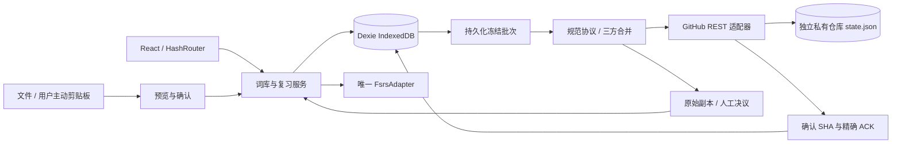
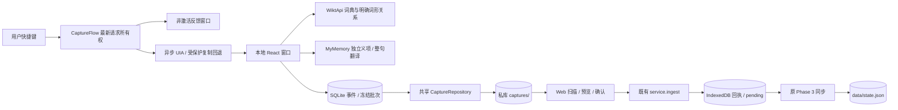

# 系统架构与模块职责（Capture 0.6.0）

基于现有本地词库、FSRS 和 GitHub 私库同步增量开发，0.6.0 统一 Windows 划词、英德词典、结构化义项、整句翻译、句中选词、稳定目录迁移及 Windows 安全授权。没有重写项目或新增云端存储，FSRS 算法与原事件身份保持。当前验收和发布状态见 [整合报告](../reports/integrated/INTEGRATED_RELEASE_REPORT.md)；旧阶段未验证的 iPhone 同步、真实401及正常跨版本更新，不因本轮模拟测试变为通过。原始 [PROJECT_PLAN](PROJECT_PLAN.md) 及 reference 原件保留。

## 数据流



本地事务修改词条/卡片/不可变事件并追加 pending；评分成功才换下一张。同步 GET/PUT、模块加载均在本机事务外。网络失败独立于学习；分叉或语义重复卡片停止调度，未冲突卡片继续使用。

## 目录与边界

```text
src/
├── app/                    # HashRouter、导航、主题、存储 provider、PWA 提示
├── components/             # Dialog、反馈、图标、下载
├── domain/                 # 共享模型、严格 Zod、引用与删除约束
├── storage/
│   ├── database.ts         # v1/v2/v3 增量表结构
│   ├── local-models.ts     # 设备默认语言、摄取回执
│   ├── sync-models.ts      # 本机连接、完整批次、租约、决议审计
│   └── capture.ts          # 固定 UUIDv5、规范化对象比较
├── features/
│   ├── home/ inbox/        # 真实统计、收词、导入
│   ├── vocabulary/         # 唯一本机词库服务、CAS、事务/outbox、编辑与查询
│   ├── review/             # 唯一算法适配、评分事务、每日任务、历史与状态校验
│   ├── import-export/      # CSV/TXT/XLSX、ZIP 预算、完整备份与受保护恢复
│   ├── capture/            # 跨平台采集契约
│   ├── settings/           # 学习设置、备份、存储与清除
│   └── sync/
│       ├── protocol.ts     # 独立云端 envelope、确定性集合序列化与严格版本保护
│       ├── merge.ts        # UUID 并集、共同基线字段、墓碑、状态因果组
│       ├── engine.ts       # 授权会话、首次确认、冻结/GET/PUT/ACK/恢复/自动触发
│       ├── persistence.ts  # 共享表的原子合并落库；不写授权/设备身份
│       ├── resolutions.ts # 冲突决议事务、ReviewResolution、重复卡片软删除
│       └── SyncSettings.tsx # 连接、状态、预览/备份确认与冲突 UI
└── integrations/
    ├── github/client.ts    # HTTPS REST、内存凭证、私有目标检查、SHA、ETag、错误分类
    └── clipboard/          # 用户手势读取与手动粘贴回退
```

根目录保留工程配置，public 保存原创图标，tests 分 unit/integration/e2e，scripts 保存产物/敏感模式检查，.github/workflows/deploy.yml 只处理公开静态构建。docs 是需求与技术说明；reports/phase-0～phase-3 是手写报告；生成的 reports/test-results、reports/playwright-report、dist、node_modules 均忽略提交。

原 Phase 0 contracts.ts 是历史接口提案，实际运行签名以 GitHubTransport、SyncEngine、SyncJob、MergeResult 为准，没有假称旧未接入方法已经执行。

## 存储与事务

Dexie v3 保留 v1 的 11 表及 v2 的 devicePreferences、ingestedCaptures，再新增 connections、syncJobs、syncLeases、conflictDecisions，共 17 表。升级只增加空表，不清库、不重写旧业务记录。schemaVersion 1 与数据库版本独立。模型、整库引用、删除证据和事件身份在初始化及共享写事务边界验证。

同步 batch 完整保存 base/local/operations/candidate/expectedSha/连接代次，提交远端前已落盘。本机 lease 90 秒、20 秒心跳；跨设备依靠 GitHub blob SHA CAS。ACK 再把冻结 local、现在 working、已确认 candidate 合并，只删本批 operation UUID；同步期间新操作保留。

冲突保留副本，复习事件和墓碑仅追加。词条与设置决议以新 revision 引用双方；原始选择副本留本机审计及备份。FSRS 决议是共享 ReviewResolution，保存选定根/终点、忽略事件、新状态 ID；后继 ReviewEvent 显式 parentResolutionId。不会平均算法数值或按时间选择。

## 凭证、缓存与性能

Web Token 是 GitHubClient 私有内存字段，不进入任何表、URL、日志、备份或构建配置。桌面 0.6.0 选择记住设备时，由 Windows 凭证管理器保存目标绑定记录，渲染器不接触 PAT；其生命周期见下文。只允许固定 api.github.com HTTPS、禁重定向和浏览器自动附带凭证、cache:no-store；断开/401/恢复后清理授权。每轮重验私有目标，404 复核仓库/分支/Contents 权限后才判断文件缺失，已确认的文件消失拒绝自动重建。

GitHub ETag 只减少无变化下载，PUT 仍使用本轮 GET 的 blob SHA。相同 SHA 的已校验快照有小型内存缓存；网络适配、合并、决议随设置页按需加载，FSRS 仅创建/评分/完整性核验时加载。Dexie 独立 vendor chunk 便于缓存，没有提高构建阈值。

生产 HTML CSP 限制脚本同源、网络仅本站与 GitHub API，禁止 object、限制 base/form；React 只渲染导入内容为文本，没有第三方运行脚本。样式允许 inline 以兼容现有 UI，CSP 不能防恶意浏览器扩展或设备软件。

Workbox 仅预缓存静态构建分块，不缓存 GitHub API 或词库；base、manifest 和 SW 作用域统一 `/polar-vocab/`，Hash 路由刷新兼容 Pages。prompt 更新不强制打断编辑。PWA 首次缓存需联网，真实安装/线上升级仍待验收。

没有自建服务器、Serverless 或云数据库，也没有 iOS 原生快捷指令。Windows 收词与免费翻译见下节，FSRS 算法保持原实现。

## Phase 4 桌面与 Web 接收边界



`packages/shared/` 重导出既有 CaptureEvent、VocabularyPayload、schema、canonicalJson 和固定 UUIDv5，并定义采集批次 envelope；没有第二套领域模型，不依赖 Electron。

`apps/desktop/src/main.ts` 管理本机协议、托盘、单实例、快捷键、IPC 和退出；`preload.ts` 只暴露具名操作。渲染器启用 sandbox/contextIsolation，关闭 Node，只加载本机 `polar://capture/` 资产，CSP 禁止联网与远程脚本。0.4.1的`capture-flow.ts`管理最新请求及取消，`selection.ts`管理隐藏的预热原生broker；`feedback-preload.ts`只允许反馈消息及渲染回执。`native/SelectionHelper.cs`仅在明确请求时读取选区，无输入/剪贴板监听，不读取密码字段，选词不作为shell参数；非激活反馈与原生读取并行，结果确认后才打开主表单。`performance.ts` 限定固定类别及耗时，不接收词文或凭证；快捷键阶段和查询阶段写入独立 JSONL，网络词典/翻译完成时间不能冒充窗口可见时间。本轮原生跨应用快捷键计时未完成，旧性能证据仍见候选修复报告。

`queue.ts` 是 SQLite outbox，不含卡片、ReviewEvent 或 FSRS；事务保证本地保存及冻结批次精确 ACK。`uploader.ts` 使用现有 GitHubClient 的私有目标检查、内存凭证与固定错误分类，只调用 captures 能力，不调用主快照写入。

`src/integrations/github/captures.ts` 负责完整树扫描预算、创建时不带 sha 的不可变上传、同内容重试及冲突拒绝。Web `CaptureInboxPanel` 绑定连接代次，确认后调用唯一词库服务。原事件、回执、词条及 pending 在既有事务中提交；相似词只提示，不替换人工释义。详见 [CAPTURE_PROTOCOL](CAPTURE_PROTOCOL.md)。

Electron/builder 是根开发依赖。Web 与 Desktop 分别构建；Pages 不下载 Electron 二进制、不运行原生打包。Windows 输出到 `artifacts/desktop/`，自动输出与真实验收配置分开，回归不清理 Phase 3.5 资料。


## Phase 4.1 词典与结构化义项边界

桌面主进程的 dictionary.ts 定义 DictionaryProvider、WiktApiProvider、DictionaryLookup；translation.ts 继续独立处理 MyMemory。网络只在主进程发起，IPC按请求ID传递词典进度与最终结果，renderer不得直接访问网络或文件。词典先展示，逐义项中文异步补充，失败保留编辑；来源、查询代次、手动修改和删除ID参与结果归并，保存停止未完成查询。

src/domain/lexicon.ts 是严格结构化模型；packages/shared/lexicon.ts 提供编辑与稳定ID归并工具；SenseEditor.tsx / SenseDetails.tsx 供桌面和Web复用。现有Queue只保存扩展后的事件JSON，无新数据库或新云服务。Web采集预览、词库和编辑器保留完整义项与来源。三方合并将lexicon作为原子字段，冲突沿用人工决议，独立标签可合并；meanings由选定义项重新投影。FSRS代码未改动。

协议2用于携带扩展字段，旧事件/旧冻结批次保持字节及身份，不原地迁移。0.5.0 阶段当时未更新公开网站的限制属于历史；0.6.0 仍要求先部署兼容 Web，再在线核对后上传，实际状态以整合报告为准。研究与调用限制见 [DICTIONARY_PROVIDERS](DICTIONARY_PROVIDERS.md)。


## 0.6.0 统一窗口与生命周期

| 模块 | 职责和边界 |
| --- | --- |
| `text-analysis.ts` | 可覆盖的单词/短语/句子分类、Unicode 分词和保留原文偏移，不推断词性 |
| `sentence.ts` / `SentencePane.tsx` | 分段、有限并行、取消与部分失败状态；原文点词、中文手改和明确保留，不阻塞划词反馈 |
| `morphology.ts` / `dictionary.ts` | 仅从词典明确 `form_of` / `alt_of` 关系返回原型候选，保留来源和歧义；不做词尾猜测 |
| `authorization.ts` / `credentials.ts` | 主进程授权代次、只读预检、记住确认、恢复及错误分类，不向 React 返回凭证 |
| `native/CredentialHelper.cs` | 原生密码输入和当前用户 Windows Credential Manager，经管道与主进程交互，无明文文件回退 |
| `migration.ts` / `queue-storage.ts` | 只读检查、含 WAL 的在线备份、副本版本升级、发布日志与恢复，不原地修改旧库 |
| `web-compatibility.ts` | 对固定正式站公开元数据做无凭证在线检查，未证明支持协议1/2及上下文扩展时阻止所有上传入口 |

主进程先准备队列，再创建主窗口；网络恢复在窗口可用后异步执行。正式队列目录固定为 `%APPDATA%\Polar Vocab\Capture`，SQLite 及固定分类日志位于其中；Chromium `userData` 使用同级 `Capture.runtime`，避免提前写缓存干扰队列迁移。队列物理版本2与采集/快照协议版本、schemaVersion各自独立。

0.6.0 将 `lemma / encounteredForm / lemmaResolution` 作为关联身份组，含译文的 contexts 作为整体三方处理，义项仍整体保留；不得拼出原词形、原型及词典证明互不对应的词条。Web 编辑器和冲突决议保留这些字段，原有 FSRS 历史与摄取 UUIDv5 不改写。

已完成的正式目录迁入来自明确选定的旧0.5.0人工候选空队列（0事件、0批次）：保留设备身份/设置、旧源、在线备份及迁移证据，副本升级v1→v2。旧默认目录没有数据库，因此不能称为自动发现并迁入未知历史数据，也没有合并所有验收目录。实际迁移和回滚细节见 [INTEGRATED_MIGRATION](INTEGRATED_MIGRATION.md)。

本轮 Web 全回归37通过/3跳过，Desktop 6通过/2跳过；真实公开 Provider 另行验证，GitHub 回归采用人工 HTTP。Windows 原生快捷键计时、真实私库全链路、正式部署结果各有独立状态，不能互相代替。完整证据以整合报告为准。
