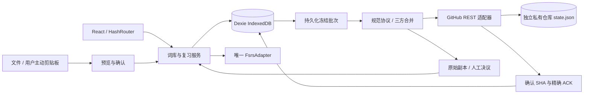

# 系统架构与模块职责（Phase 3）

基于原有本地词库与真实 FSRS，新增独立 GitHub 同步能力。模拟 API、双设备和浏览器验证见阶段报告，真实私有仓库、iPhone 和远程部署仍未验收。原始 [PROJECT_PLAN](PROJECT_PLAN.md) 及 reference 原件保留。

## 数据流



本地事务修改词条/卡片/不可变事件并追加 pending；评分成功才换下一张。同步 GET/PUT、模块加载均在本机事务外。网络失败独立于学习；分叉或语义重复卡片停止调度，未冲突卡片继续使用。

## 目录与边界

```text
src/
├── app/                    # HashRouter、导航、主题、存储 provider、PWA 提示
├── components/             # Dialog、反馈、图标、下载
├── domain/                 # 共享模型、严格 Zod、引用与删除约束
├── storage/
│   ├── database.ts         # v1/v2/v3 增量表结构
│   ├── local-models.ts     # 设备默认语言、摄取回执
│   ├── sync-models.ts      # 本机连接、完整批次、租约、决议审计
│   └── capture.ts          # 固定 UUIDv5、规范化对象比较
├── features/
│   ├── home/ inbox/        # 真实统计、收词、导入
│   ├── vocabulary/         # 唯一本机词库服务、CAS、事务/outbox、编辑与查询
│   ├── review/             # 唯一算法适配、评分事务、每日任务、历史与状态校验
│   ├── import-export/      # CSV/TXT/XLSX、ZIP 预算、完整备份与受保护恢复
│   ├── capture/            # 跨平台采集契约
│   ├── settings/           # 学习设置、备份、存储与清除
│   └── sync/
│       ├── protocol.ts     # 独立云端 envelope、确定性集合序列化与严格版本保护
│       ├── merge.ts        # UUID 并集、共同基线字段、墓碑、状态因果组
│       ├── engine.ts       # 授权会话、首次确认、冻结/GET/PUT/ACK/恢复/自动触发
│       ├── persistence.ts  # 共享表的原子合并落库；不写授权/设备身份
│       ├── resolutions.ts # 冲突决议事务、ReviewResolution、重复卡片软删除
│       └── SyncSettings.tsx # 连接、状态、预览/备份确认与冲突 UI
└── integrations/
    ├── github/client.ts    # HTTPS REST、内存凭证、私有目标检查、SHA、ETag、错误分类
    └── clipboard/          # 用户手势读取与手动粘贴回退
```

根目录保留工程配置，public 保存原创图标，tests 分 unit/integration/e2e，scripts 保存产物/敏感模式检查，.github/workflows/deploy.yml 只处理公开静态构建。docs 是需求与技术说明；reports/phase-0～phase-3 是手写报告；生成的 reports/test-results、reports/playwright-report、dist、node_modules 均忽略提交。

原 Phase 0 contracts.ts 是历史接口提案，实际运行签名以 GitHubTransport、SyncEngine、SyncJob、MergeResult 为准，没有假称旧未接入方法已经执行。

## 存储与事务

Dexie v3 保留 v1 的 11 表及 v2 的 devicePreferences、ingestedCaptures，再新增 connections、syncJobs、syncLeases、conflictDecisions，共 17 表。升级只增加空表，不清库、不重写旧业务记录。schemaVersion 1 与数据库版本独立。模型、整库引用、删除证据和事件身份在初始化及共享写事务边界验证。

同步 batch 完整保存 base/local/operations/candidate/expectedSha/连接代次，提交远端前已落盘。本机 lease 90 秒、20 秒心跳；跨设备依靠 GitHub blob SHA CAS。ACK 再把冻结 local、现在 working、已确认 candidate 合并，只删本批 operation UUID；同步期间新操作保留。

冲突保留副本，复习事件和墓碑仅追加。词条与设置决议以新 revision 引用双方；原始选择副本留本机审计及备份。FSRS 决议是共享 ReviewResolution，保存选定根/终点、忽略事件、新状态 ID；后继 ReviewEvent 显式 parentResolutionId。不会平均算法数值或按时间选择。

## 凭证、缓存与性能

Token 是 GitHubClient 私有内存字段，不进入任何表、URL、日志、备份或构建配置。只允许固定 api.github.com HTTPS、禁重定向和浏览器自动附带凭证、cache:no-store；断开/401/恢复后清理授权。每轮重验私有目标，404 复核仓库/分支/Contents 权限后才判断文件缺失，已确认的文件消失拒绝自动重建。

GitHub ETag 只减少无变化下载，PUT 仍使用本轮 GET 的 blob SHA。相同 SHA 的已校验快照有小型内存缓存；网络适配、合并、决议随设置页按需加载，FSRS 仅创建/评分/完整性核验时加载。Dexie 独立 vendor chunk 便于缓存，没有提高构建阈值。

生产 HTML CSP 限制脚本同源、网络仅本站与 GitHub API，禁止 object、限制 base/form；React 只渲染导入内容为文本，没有第三方运行脚本。样式允许 inline 以兼容现有 UI，CSP 不能防恶意浏览器扩展或设备软件。

Workbox 仅预缓存静态构建分块，不缓存 GitHub API 或词库；base、manifest 和 SW 作用域统一 `/polar-vocab/`，Hash 路由刷新兼容 Pages。prompt 更新不强制打断编辑。PWA 首次缓存需联网，真实安装/线上升级仍待验收。

没有自建服务器、Serverless、云数据库、Windows 客户端、iOS 原生快捷指令或词典/AI 集成。本阶段仅 Phase 3。
