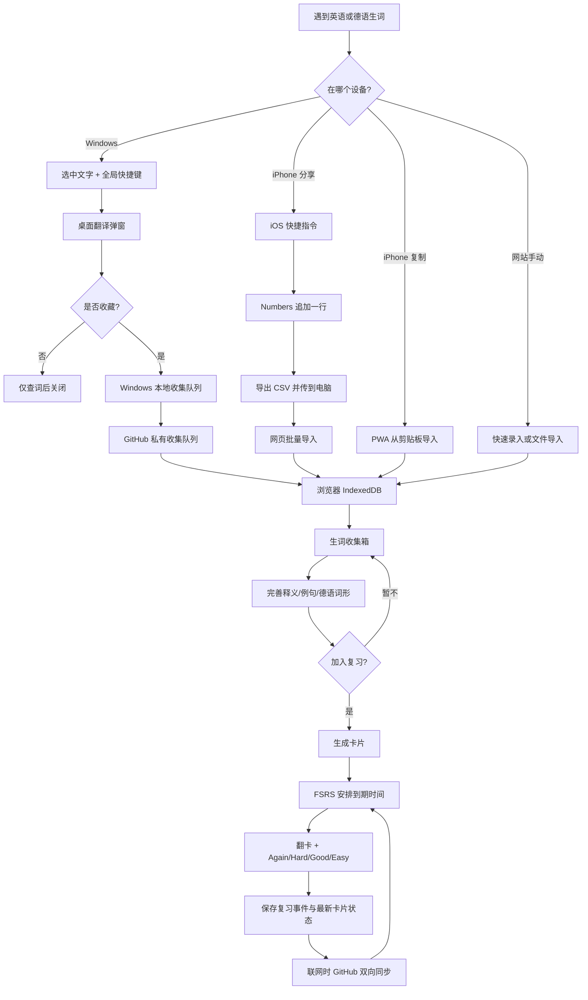
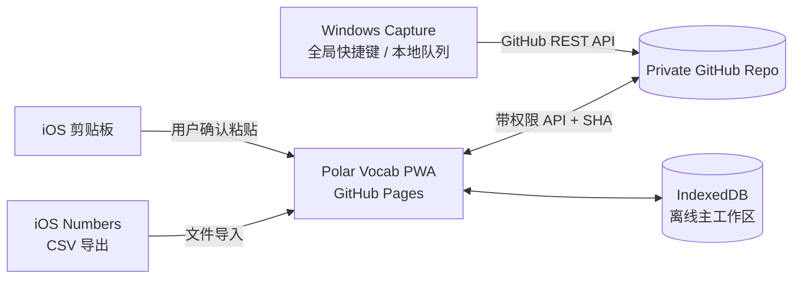
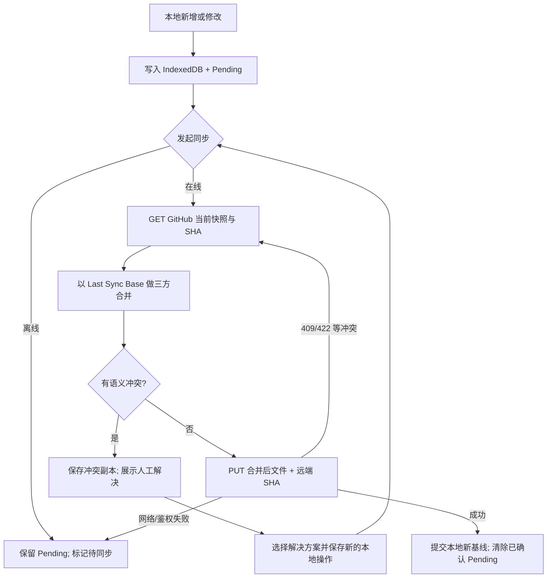

# Polar Vocab｜个人英德双语词汇收集与间隔复习系统

> **项目全流程规划与开发规格说明（PRD + 技术设计草案）**  
> 版本：v1.0（规划稿）  
> 日期：2026-10-13  
> 状态：需求已确认；尚未开始实施  
> 开发方式：以 Codex 辅助开发为主，分阶段交付和验收

---

## 0. 一页摘要

**一句话目标：** 将在电脑、iPhone 和网页上零散查到的英语、德语单词，低摩擦地收进私人词库，再通过 FSRS 间隔复习；所有数据由自己掌控，运行过程**不需要自建服务器、云数据库或后端函数**。

**已经确定的关键选择：**

1. **纯静态网站：** React + TypeScript + Vite + GitHub Pages，安装为 PWA。
2. **个人数据私有：** 另建 GitHub Private 仓库保存词条、卡片与复习记录；网站代码公开，个人数据不公开。
3. **本地优先：** IndexedDB 保存缓存和未同步操作；离线可以收词、整理和复习。
4. **定期复习：** 使用 `ts-fsrs`，不重新发明调度算法。
5. **Windows 端：** 全局快捷键抓取选中单词 → 弹出翻译/编辑窗口 → 用户选择「保存生词」或「仅查看」。
6. **iOS 端 A：** 系统快捷指令接收分享的单词，追加到 Numbers 表格；导出 CSV，经电脑导入网站。
7. **iOS 端 B：** 复制单词后打开 Polar Vocab PWA，点击「从剪贴板导入」，直接进入本地生词箱，之后 GitHub 同步；不必经过电脑。
8. **批量导入：** CSV 优先，兼容 XLSX、TXT 和本项目 JSON；有预览、字段映射、去重与错误报告。
9. **坚持数据安全：** GitHub 同步必须处理版本冲突；本地未同步操作不能被远端下载覆盖。

### 明确不做的事

- 不购买或维护 VPS，不开发常驻后端，不上 Supabase/Firebase 等云数据库。
- 不把访问令牌写进前端代码、GitHub Actions 配置或公开仓库。
- 不要求 iOS 原生 App；iOS 用快捷指令、Numbers 和 PWA 即可。
- 不把所有「查过」的词强行加入复习；先收集，之后再选择是否制作卡片。
- 初期不实现社交功能、多人协同、排行榜、付费词典或 AI 大模型深度集成。

> **安全与权限边界：** GitHub Pages 网站地址仍可被任何人访问；真正受保护的是私有仓库数据。界面上的「登录页」本身不能对公开静态资源形成服务器级访问控制。

---

## 1. 项目背景、用户与目标

### 1.1 实际痛点

- 英语阅读、日常交流、技术资料和德语学习中，生词产生得随机且零散。
- 临时查词后容易遗忘；手工整理单词、释义、原句耗费精力。
- 简单记在笔记中没有复习时间规划；直接进入背词软件又容易形成大量待背单词。
- 希望手机、平板和 Windows 电脑之间同步，同时不承担维护服务器的成本。

### 1.2 成功标准

- **快速收集：** Windows 划词到「已加入收集箱」，一般只需一个快捷键和一次确认。
- **移动便捷：** iOS 至少两条有效路线：快捷指令→Numbers/CSV，以及 PWA→剪贴板直存。
- **低整理成本：** 新词允许只有语言和词形；词性、释义、原句等可后补。
- **每天可用：** 进入主页即可看到英/德两种语言的到期卡片和新词。
- **可迁移：** 全量 JSON 备份，词汇 CSV 导出；不依赖某一款封闭 App。
- **可恢复：** 断网、刷新、Token 失效或同步冲突不会直接导致未同步数据消失。

### 1.3 典型使用场景

| 场景 | 理想动作 | 存储落点 |
|---|---|---|
| Windows 浏览器或 PDF 看见生词 | 选词 → 全局快捷键 → 看释义 → 收藏 | 桌面本地队列，随后 GitHub 私有仓库 |
| iPhone 读文章，想快速记录 | 分享所选文本 →「保存生词」快捷指令 | Numbers 表格，稍后 CSV 导入 |
| iPhone 只复制了一个词 | 打开 PWA →「从剪贴板导入」→ 确认 | 浏览器 IndexedDB，随后 GitHub 私有仓库 |
| 电脑整理一批旧词 | 导入 CSV / XLSX / TXT → 检查 → 入库 | 浏览器 IndexedDB，随后同步 |
| 每日背词 | 今日到期 → 翻卡 → 自评 | 本地复习事件，随后同步 |
| 换新电脑/手机 | 打开网站 → 授权数据仓库 → 拉取记录 | GitHub Private → 本机 IndexedDB |

---

## 2. 全流程：从发现生词到长期记住



**核心产品哲学：**「看到 → 收到」尽可能快；「整理 → 记忆」允许在有空的时候进行。查词行为和背词承诺不是同一件事。

---

## 3. 功能范围与优先级

优先级：**P0** = 第一版必须实现；**P1** = 核心闭环稳定后；**P2** = 长期增强。

| 模块 | 功能 | 优先级 |
|---|---|---|
| 主页 | 英德分别显示到期数、待整理数、今日完成数 | P0 |
| 生词箱 | 单个词快速收集、语言选择、原句/来源选填 | P0 |
| 生词箱 | 从系统剪贴板导入、手动粘贴回退 | P0 |
| 词汇库 | 搜索、编辑、标签、状态、建议去重 | P0 |
| 导入导出 | CSV、TXT、完整 JSON；批量预览和字段映射 | P0 |
| 导入导出 | XLSX 文件读取、Numbers 导出 CSV 适配 | P0 |
| 复习 | `ts-fsrs`、翻卡、自评、英德独立配额 | P0 |
| 数据 | IndexedDB 离线持久化、导出备份 | P0 |
| 同步 | GitHub 私有仓库、SHA 检查、冲突处理 | P0 |
| PWA | 手机添加到主屏幕、基础离线访问 | P0 |
| Windows | 全局选词抓取、弹窗、仅查看/收藏 | P1 |
| Windows | 本地离线队列 + GitHub 同步 | P1 |
| iOS | Numbers 快捷指令操作教程、CSV 模板 | P1（可和 P0 并行） |
| 词典 | 英语/德语释义、词性、发音候选 | P1 |
| 复习 | 德语冠词专项、反向卡、输入拼写 | P2 |
| 收集 | 自动提取长句关键词、iOS 分享链接集成 | P2 |
| 统计 | 复习趋势、易忘词、标签表现、热力图 | P2 |
| 智能辅助 | AI 基于上下文解释和示例，不自动写入未经确认的结果 | P2 |

---

## 4. 用户界面与交互规范

### 4.1 信息架构

```text
Polar Vocab
├── 首页 / 今日学习
│   ├── 英语：到期 / 今日新增 / 已完成
│   ├── 德语：到期 / 今日新增 / 已完成
│   └── 快速入口：开始复习 / 添加单词 / 从剪贴板导入
├── 生词箱
│   ├── 快速录入
│   ├── 剪贴板录入
│   ├── 待整理词条
│   ├── 批量审核
│   └── 导入 Windows 收集记录
├── 复习
│   ├── 英语卡组
│   ├── 德语卡组
│   ├── 正面 / 答案 / 自评
│   └── 今日结果
├── 词汇库
│   ├── 搜索 / 标签 / 来源 / 语言
│   ├── 编辑词条 / 合并重复
│   └── 启用 / 暂停 / 归档卡片
└── 设置
    ├── 每日新词限额 / 复习设置
    ├── GitHub 私有仓库连接与同步
    ├── 导入、导出和备份
    ├── 本机缓存及凭证管理
    └── 帮助与快捷指令说明
```

- 桌面端：侧边导航、宽表格、键盘操作优先。
- 手机端：底部导航、大触控区域；首页突出「今天复习」和「粘贴生词」。
- 保持简洁、中文优先、暗色模式可选，不在第一版加入复杂动画。
- 空状态需要可操作：例如「还没有单词，粘贴一个试试」。
- 所有重要写操作显示「本地已保存 / 待同步 / 已同步 / 冲突待处理」，不让用户误以为本地保存就是云端成功。

### 4.2 最小录入表单

必填：`语言（en/de）`、`word（词形）`。

选填：`meaning（中文释义）`、`context（原句）`、`source（来源）`、`tags（标签）`。

默认状态：`inbox（待整理）`。点击「加入复习」时再创建记忆卡片，避免待复习队列被零碎词条淹没。

### 4.3 复习卡片

- 正面先展示原词及可选提示；背面显示中文释义、上下文、主要变形等。
- 四级评价：Again（重来）、Hard（困难）、Good（良好）、Easy（简单）。
- 回答只记录自评分；第一版不承诺系统自动判断拼写正确性。
- 每个单词可有多张卡片，但初始**只生成一张「看到外语 → 回忆中文」卡片**。
- 设置分别控制英语、德语每日新卡片量，建议默认初始值：英语 10、德语 5；均可调整。
- FSRS 目标保持率初始为 0.90；提供设置入口，但第一版不做参数自动拟合。

---

## 5. Windows 桌面收集器（Polar Vocab Capture）

### 5.1 必须实现的交互

1. Windows 任意**可复制文本**应用（浏览器、Word、PDF 阅读器、编辑器）里选中单词。
2. 按可配置的全局快捷键，例如 `Ctrl + Alt + S`。
3. 桌面工具尝试复制选中文字，尽可能保存并恢复原剪贴板内容。
4. 弹出小窗口展示选词；如果有词典能力，则展示译文候选和词性。
5. 选择 `仅查看`、`保存到生词箱`、`编辑后保存`。
6. 收藏后先写本机队列，即使 GitHub 无法访问也能保留；联网时批量同步。

### 5.2 弹窗信息

```text
┌───────────────────────────────────┐
│ Polar Vocab Capture              │
│ sophisticated              EN ▼  │
│ 释义候选：精密复杂的；老练的       │
│ 原句（可选）：_________________    │
│ 来源：网页 / PDF / 手动           │
│                                   │
│ [仅查看] [编辑] [保存生词]        │
└───────────────────────────────────┘
```

### 5.3 实施方案

**首选：** AutoHotkey v2 + 简单 GUI + 本地 JSON 队列。适合先解决快捷键与选词；可以先只提供「词形 + 手动释义 / 跳转词典」而不阻塞主体系统。

**替代：** 使用现成划词翻译工具的插件接口，例如 Pot 的生词本插件模板；其项目维护状态与许可证需要在真正复用源码之前重新评估。

**高级版可选：** 后续需要复杂悬浮窗、音频、词典插件时再考虑 Tauri，不作为必需前提。

### 5.4 关键限制与降级

- 部分软件不允许复制选中内容；扫描版 PDF、图片文字需要额外 OCR，不属于第一版强制范围。
- `Ctrl+C` 模拟复制的过程中可能与剪贴板管理软件冲突：失败时保留人工输入，不删除原剪贴板内容。
- 仅选中一个词，不等于可以可靠获取其前后整句；原句保持选填。
- 不尝试读取密码框、私密输入控件和未经用户操作的后台窗口。
- 不在系统后台持续监控所有复制内容；仅当用户触发快捷键才抓取。

### 5.5 桌面 → GitHub 同步方式

桌面端**不需要背词界面**，只需上传待整理记录。推荐桌面专用收集文件：

```text
captures/windows-<device-id>/2026-10.json
```

- 单机队列先落盘；批量向此设备自己的 `captures` 文件提交，SHA 冲突时读取新版本再重试。
- 每条捕获记录具有不可重复的 `captureId`，方便网页幂等导入。
- 网页拉取 `captures` 中的记录，去重并合并到词库生词箱；记录已摄取的 ID。
- **不要让桌面工具直接修改 FSRS 复习状态**。这样能降低桌面和网页写同一个文件时的冲突。
- 后期为捕获文件设计按月分片、历史归档；初期可限制每文件大小。
- 数据仓库只需 `Contents` 读写权限，不需要桌面工具运行 Git CLI。

---

## 6. iOS 收集方案 A：快捷指令 + Numbers + CSV

### 6.1 作用定位

这是一条**独立于 GitHub 登录的保底采集路线**。适合在手机里看到生词，却不想立刻打开网站、不想输入 GitHub Token，也可能暂时没有网络的时候使用。

### 6.2 快捷指令建议名称

`Polar Vocab · 保存生词`

设置「在共享表单中显示」，输入类型以文本为主。支持：

- 从其他 App 共享选中文字；
- 如果没有共享文本，选择从剪贴板读取；
- 如果依旧取不到内容，弹出文本输入框手动输入。

### 6.3 快捷指令动作（逻辑步骤）

1. 获取 `快捷指令输入`；为空则尝试 `获取剪贴板`。
2. 修剪首尾空格；允许用户确认或编辑词形。
3. `从菜单中选择`：英语 / 德语；可选记住上次选择。
4. `询问输入`：中文释义（允许跳过）。
5. `询问输入`：原句或来源（允许跳过；可配置简洁模式取消这一步）。
6. 获取当前日期，格式化为 ISO 风格字符串（注意所在时区）。
7. 使用 Numbers 动作「在表格顶部或底部添加行」（具体中文名称随系统版本可能有差异），把字段分别写入不同单元格。
8. 显示「已保存到收集表」；若失败，明确报错，不伪称成功，并保留输入以便重试。

### 6.4 Numbers 模板

建议仅使用**一个工作表、一张规范表格**，避免导出多个 CSV 或列名混乱。

| word | lang | meaning | context | source | created_at |
|---|---|---|---|---|---|
| sophisticated | en | 复杂精密的 | a sophisticated control system | Safari | 2026-10-13T22:10:00+08:00 |
| Entscheidung | de | 决定 | eine Entscheidung treffen | 阅读 | 2026-10-13T22:12:00+08:00 |

- `word` 与 `lang` 必填，其余列留空也有效。
- 推荐语言值固定为 `en` 和 `de`，别混用「英文 / English / EN」。
- 不需要 Numbers 和 Excel 共存：**Numbers 是苹果的电子表格 App，CSV 是最终交换格式**。

### 6.5 转入电脑与导入网站

```text
iPhone 选词
  → iOS 快捷指令
  → Numbers 追加记录
  → Numbers「导出」CSV
  → 通过文件、iCloud Drive、聊天传文件等方式发送到 Windows
  → Polar Vocab 网站「导入 CSV」
  → 预览、去重、确认
  → 本地入库并同步到 GitHub Private
```

导入**不能默认删除原 Numbers 表格内容**。网页确认成功后，用户可手动归档旧表或另建新表，避免导出失败造成记录丢失。

---

## 7. iOS 收集方案 B：PWA 从剪贴板直接导入（新增确认需求）

### 7.1 用户交互

1. 在 iPhone 任意允许复制文本的应用中复制单词。
2. 打开主屏幕上的 `Polar Vocab` PWA，进入首页或「快速添加」。
3. 主动点击 `从剪贴板导入`。
4. PWA 尝试使用 `navigator.clipboard.readText()` 获取文本。
5. 显示预览：识别出的词形、默认语言、可选释义/原句。
6. 用户确认后写入 IndexedDB 生词箱。
7. 若网页已连接私有数据仓库，则在后续同步时上传；未连接也可先离线保存。

### 7.2 为什么不能偷偷自动读取？

剪贴板读取受到浏览器权限、用户手势及安全上下文限制。GitHub Pages 提供 HTTPS，但 **Safari / iOS 上仍可能弹出粘贴确认，或者拒绝直接读取**。

因此必须有以下兜底交互：

```text
[从剪贴板导入]
       │
       ├─ 成功：出现可编辑的单词预览
       │
       └─ 被拒绝 / 不支持：显示输入框
                         └─ 用户长按 →「粘贴」→ 保存
```

- 默认**不在页面加载时自动读取**剪贴板，也不定期扫描剪贴板。
- 成功读取不等于必须保存，始终经过一次用户确认。
- 对于整段文字，V1 直接作为待选文本提供编辑；不要擅自把所有空格分隔词全部导入。
- PWA 的剪贴板功能需在真机 Safari 与「添加到主屏幕」模式分别测试。
- 这条路线不要求发送文件到电脑，属于 **iOS → 网页 → GitHub 私有仓库** 的直接路径。

### 7.3 与 Numbers 路线的关系

两条路线都保留：

| 特性 | PWA 剪贴板导入 | Numbers 快捷指令 |
|---|---|---|
| 是否需要打开 Polar Vocab | 需要 | 不需要 |
| 是否需要额外导出 CSV | 不需要 | 需要 |
| 是否依赖 Safari 剪贴板授权 | 可能受限制，有手动粘贴兜底 | 不依赖网页剪贴板授权 |
| 能否离线记录 | 可以，写入 IndexedDB | 可以，写入本地表格（视文件可用性） |
| 最适合 | 偶尔查一个词、马上整理 | 一天多次零散收词、晚些时候批量整理 |

**结论：** 优先提供 PWA 快速导入的顺滑体验；Numbers 是稳定、可核对、可导出的备用收集通道，不相互取代。

---

## 8. CSV / Excel / 文本批量导入规格

### 8.1 文件支持

- `.csv`：首选、必须完整支持，UTF-8、BOM、带引号与换行的单元格、不同分隔符识别。
- `.xlsx`：解析首个用户选择的表/工作表，支持预览，不能让日期默默变成序列号。
- `.txt`：按行导入（至少单词），默认语言由用户选定。
- `.json`：本项目完整备份结构，区分「恢复备份」与「合并导入词汇」两种操作。
- `.numbers`：**不直接解析**，提示先在 Numbers 中导出为 CSV 或 Excel。

### 8.2 数据导入流程

1. 选择文件或拖入文件。
2. 解析并预览前若干行，同时显示总行数。
3. 自动识别列名，可手动映射 `word/lang/meaning/context/source/created_at/tags`。
4. 验证必填字段、语言码、超长文本、不合法日期。
5. 按标准化词形给出**潜在重复项提示**，但不得无提示直接覆盖已有释义。
6. 对重复项提供：跳过、合并空白字段、仍然导入为独立词条。
7. 显示「准备新增 N 条、可能重复 M 条、失败 K 条」。
8. 用户确认后**原子地保存本地**，生成单条批量导入操作记录。
9. 本地保存成功后再进行 GitHub 同步；上传失败也不丢数据。

### 8.3 去重规则

- 默认提示键：`language + Unicode 规范化后的词形`。
- 英语可以使用小写对照查重，但**不能误把大小写与多义词合并成一个含义**。
- 德语大小写、词形和冠词具有实际意义，严格区分原词展示值；只把大小写近似视作「可疑重复」。
- 相同词在不同语境有不同释义时，优先用同一词条下的义项/例句管理，仍允许用户分开记录。
- 所有数据都保存稳定 UUID，不使用 `word` 本身当数据库主键。

### 8.4 CSV 模板

```csv
word,lang,meaning,context,source,created_at,tags
sophisticated,en,复杂精密的,a sophisticated machine,Safari,2026-10-13T22:10:00+08:00,技术阅读
Entscheidung,de,决定,eine Entscheidung treffen,Numbers,2026-10-13T22:12:00+08:00,德语A1
```

对带逗号、双引号、换行的字段，导入/导出应按 CSV 规范正确转义，禁止只使用字符串 `split(',')`。

导出 CSV 若用于 Excel/Numbers，需要防止以 `=`, `+`, `-`, `@` 等开头的单元格被当作公式执行；保留无损 JSON 作为权威备份格式。

---

## 9. 英语、德语词条模型

### 9.1 共同字段

| 字段 | 说明 |
|---|---|
| `id` | 永久 UUID |
| `lang` | `en` / `de` |
| `lemma` | 词条原形，保留正确大小写 |
| `meanings` | 一个或多个中文释义/义项 |
| `partOfSpeech` | 词性，选填 |
| `contexts` | 原句及其来源，可多个 |
| `tags` | 自定义分类 |
| `origin` | 录入来源：web/clipboard/ios-csv/windows/manual |
| `status` | inbox / learning / paused / archived |
| `createdAt` / `updatedAt` | ISO 8601 时间戳 |
| `deletedAt` | 删除标记（软删除） |

### 9.2 英语扩展字段

- 音标与发音资源地址（可选）；
- 常见搭配，如 `contribute to`；
- 不规则变形/派生词；
- 特定原句中的释义，而不是只堆词典所有意义。

### 9.3 德语扩展字段

- 名词：定冠词（der/die/das）、复数形式；
- 动词：不定式、常用过去式、第二分词、助动词、可分前缀；
- 介词或动词格支配；
- 形容词/副词：比较级与最高级（可选）；
- 对复合词支持备注与拆分，不要求第一版自动解析。

**德语录入习惯建议：** 显示名词时将冠词视为学习内容，例如 `die Entscheidung`；底层仍将 `Entscheidung` 和 `die` 分开存储，方便不同卡片类型复用。

### 9.4 词条与卡片为什么分离

一个词条可以派生多张不同考察目标的卡片：

```text
Lexeme: die Entscheidung
  ├─ Card A: die Entscheidung → 决定
  ├─ Card B: ___ Entscheidung → die
  └─ Card C: 中文「决定」→ 写出 Entscheidung（未来）
```

每张卡片拥有**独立 FSRS 状态**。V1 只自动创建 A，B/C 等用户明确启用后再创建。

---

## 10. FSRS 复习与任务生成

### 10.1 算法及参数

- 核心依赖：`ts-fsrs`（锁定实际安装版本，版本升级前跑迁移回归测试）。
- 默认目标保持率：`0.90`。
- 英德分开设置新卡片限额、是否参与今日复习与展示筛选；FSRS 同一套库复用。
- 复习结果：Again / Hard / Good / Easy。
- 使用库的真实 `next()` 调度接口，不根据「第一天第三天第七天」硬编码周期。

### 10.2 复习状态与复习历史

**必须同时保存：**

1. 卡片当前可用的 FSRS 状态（便于迅速查询今日到期）。
2. 每次实际复习事件（用于回放、统计、跨端合并与修复）。
3. 采用的算法版本、配置快照/版本标记（避免未来更新库后无法解释旧状态）。

**复习事件不允许被简单覆盖。** 同一事件合并后靠稳定 `eventId` 去重。

### 10.3 多端重复复习冲突

例：同一张卡片在电脑离线时复习了一次，同时在 iPhone 离线时也复习了一次。同步时**不能无脑把两次评分串联**，否则 FSRS 会把同一学习阶段误当连续复习。

V1 策略：

- 保存两次原始事件，不丢弃历史。
- 根据其父状态/复习基线判断是否分叉。
- 把该卡片标记为「复习分支冲突」，暂停自动重算。
- 在冲突页让用户选定有效分支（或按明确规则保留一条、另一条记为重复），产生解决事件。
- 清晰展示处理结果后再更新派生的卡片调度状态。

这比一味追求全自动但悄悄算错更合适。

### 10.4 日常任务

- 当日到期卡片按 `due <= now` 判断，界面基于本地日期分组展示。
- `new` 卡片由新卡片额度控制；未来可加学习中卡片优先级和暂停卡片规则。
- 应区分「今天没有到期卡片」和「同步未成功 / 数据没加载」。
- 每个操作先持久化本地，提交完成后才移动到下一张卡。

---

## 11. 无后端技术架构

### 11.1 三个逻辑部分



- GitHub Pages **只交付 HTML/JS/CSS 静态资产**，不负责处理个人数据认证。
- 运行在浏览器里的程序使用用户输入的 Fine-grained PAT，通过 HTTPS 请求 GitHub REST API。
- IndexedDB 是运行时工作区；GitHub Private 仓库是跨端同步与版本化数据位置。
- Windows 不需要依赖网页常驻运行，允许独立收词后上传队列。
- iOS 的 Numbers 内容在正式导入前只是本地收集素材，**并非已经进入 GitHub 词库**。

### 11.2 技术栈

| 部位 | 推荐 | 原因 |
|---|---|---|
| 前端 | React + TypeScript + Vite | 组件清楚，Codex 易维护 |
| 样式 | Tailwind CSS | 响应式 UI 开发效率高 |
| 本地持久化 | Dexie（IndexedDB） | 适合事务、查询及结构化数据 |
| 复习 | `ts-fsrs` | 成熟算法封装 |
| CSV | Papa Parse 或同类库 | 支持引号、分隔符和编码处理 |
| XLSX | SheetJS 或适合浏览器的解析库 | 注意许可证、依赖体积和供应链审查 |
| PWA | Vite PWA 插件 | 安装及缓存策略 |
| 云端同步 | GitHub REST Contents API | 私有仓库读写，无自建后端 |
| Windows | AutoHotkey v2（第一版） | 全局快捷键与系统剪贴板调用简便 |
| 自动部署 | GitHub Actions → Pages | 不配置服务器 |

### 11.3 推荐仓库划分

```text
GitHub
├── polar-vocab                 # PUBLIC：网站源码与静态页面
│   ├── src/
│   │   ├── app/
│   │   ├── features/
│   │   │   ├── inbox/
│   │   │   ├── vocabulary/
│   │   │   ├── review/
│   │   │   ├── import-export/
│   │   │   └── sync/
│   │   ├── domain/            # 词条、卡片、事件、规则
│   │   ├── storage/           # Dexie 与迁移
│   │   ├── integrations/      # GitHub / clipboard
│   │   └── components/
│   ├── public/
│   ├── tests/
│   ├── docs/
│   └── .github/workflows/deploy.yml
│
├── polar-vocab-data            # PRIVATE：个人数据
│   ├── data/state.json         # 主要词库/卡片/复习事件快照
│   ├── captures/
│   │   └── windows-<device-id>/
│   │       └── 2026-10.json    # 桌面工具批量收词
│   └── backups/                # 可选，不强制在线存多份
│
└── polar-vocab-capture         # 可选 PUBLIC 或 PRIVATE：Windows 工具源码
    ├── src/
    ├── tests/
    └── docs/
```

**注意：** 主网站仓库内的 `data/` 绝对不能放真实词库。网站若有演示词条，只能使用人工编写的公开样例。

### 11.4 GitHub Pages 部署细节

- 使用 GitHub Actions 构建和发布；生产打包绝不注入个人 Token。
- `vite.config` 的 `base` 需与 `/<repo>/` 子路径对应（如使用个人根域名则另外配置）。
- SPA 路由优先采用 HashRouter，或者显式解决 GitHub Pages 深层 URL 刷新 404。
- PWA `manifest` 的 `start_url/scope/icons` 应采用部署后的正确子路径。
- Service Worker **只缓存静态应用资源**；认证 API 请求不纳入公开缓存策略。
- 首次打开 PWA 需要联网获取应用资源；之后离线行为仍需真机验证。

---

## 12. 数据结构草案

以下为**语义示例**，不是已经确定的正式 TypeScript 源码。开发时先定义 schema、版本与验证器。

### 12.1 Lexeme（词条）

```ts
type Language = 'en' | 'de';
type LexemeStatus = 'inbox' | 'learning' | 'paused' | 'archived';

type Context = {
  id: string;
  text: string;
  source?: string;
};

type Lexeme = {
  id: string;
  lang: Language;
  lemma: string;
  meanings: string[];
  partOfSpeech?: string;
  contexts: Context[];
  tags: string[];
  origin: 'manual' | 'clipboard' | 'ios-csv' | 'windows' | 'web';
  status: LexemeStatus;
  en?: { collocations?: string[]; inflections?: string[] };
  de?: {
    article?: 'der' | 'die' | 'das';
    plural?: string;
    past?: string;
    participleII?: string;
    auxiliary?: 'haben' | 'sein';
    government?: string[];
  };
  createdAt: string;
  updatedAt: string;
  deletedAt?: string | null;
};
```

### 12.2 Card（记忆卡片）

```ts
type CardTemplate = 'meaning' | 'article' | 'reverse' | 'spelling';

type StudyCard = {
  id: string;
  lexemeId: string;
  template: CardTemplate;
  suspended: boolean;
  // 由 ts-fsrs 生成的可序列化状态，具体字段以锁定的库版本为准。
  fsrsState: unknown;
  schedulerVersion: string;
  updatedAt: string;
};
```

### 12.3 ReviewEvent（不可变复习事件）

```ts
type ReviewEvent = {
  id: string;
  cardId: string;
  deviceId: string;
  reviewedAt: string; // UTC ISO 8601
  rating: 'Again' | 'Hard' | 'Good' | 'Easy';
  parentReviewId?: string | null;
  schedulerVersion: string;
  settingsVersion: string;
  resolution?: 'effective' | 'duplicate' | 'conflict';
};
```

设计时必须注意：GitHub JSON 的类型定义、浏览器 Dexie 类型和 Windows 收集 JSON 协议要一致；使用显式的 schemaVersion 与迁移测试，不能依赖 JS 的运行时猜测。

### 12.4 私有仓库主快照（最简版）

```json
{
  "schemaVersion": 1,
  "exportedAt": "2026-10-13T14:10:00Z",
  "lexemes": {},
  "cards": {},
  "reviewEvents": {},
  "tombstones": {},
  "ingestedCaptureIds": [],
  "settings": {
    "dailyNewEn": 10,
    "dailyNewDe": 5,
    "desiredRetention": 0.9
  }
}
```

记录量小的时候使用一个主快照，便于一次 SHA 乐观锁更新。**不要假定大型数据集永远适合单文件**：卡片和复习历史持续增加后，需要分片、归档或使用 Git Data API 的增量提交方案；这一点属于规模化优化，不属于第一阶段先做复杂的必要理由。

---

## 13. 多端同步协议（必须重点测试）

### 13.1 状态标识

- `Local working state`：IndexedDB 当前已保存的数据。
- `Last sync base`：本机上一次成功同步的已知公共基线。
- `Remote snapshot + SHA`：GitHub 当前私有数据快照及对应 blob SHA。
- `Pending operations`：本机仍未确认上传的操作/事件。

### 13.2 推荐同步状态机



### 13.3 合并原则

1. **新增：** UUID 集合合并，同一 ID 不重复插入。
2. **编辑：** 同词条不同字段可以三方合并；同一字段双端同时改动时保留冲突信息，请用户决定。
3. **删除：** 使用 tombstone，不能让离线旧设备同步时把删除内容「复活」。
4. **复习日志：** 同一 `eventId` 幂等；同一卡片从同一父状态分叉的评分进入冲突决议流程。
5. **导入：** CSV 与 Windows Capture 均有稳定导入 ID；重复导入要报告和去重。
6. **时间：** 时间戳用于排序/展示，不用「设备时间较晚」替代所有冲突判定；设备时钟可能不准。
7. **失败：** PUT 未成功前不能清除 Pending；失败重试应幂等。
8. **远端更新：** 下载时不直接替换整个 IndexedDB 的本地状态。

### 13.4 同步触发时机

- 用户打开网站且已经授权时，尝试拉取更新；
- 用户主动点「同步」；
- 结束一次复习会话或批量整理后，尝试上传一批操作；
- 页面重新联网时，如页面处于活动状态，可尝试一次同步；
- 不要求在浏览器关闭后依然保证后台自动上传。

**不做：** 每翻一张卡片就发起一次 Git commit。

### 13.5 同步状态和故障提示

- 已同步：本地数据与最近一次确认的 GitHub 快照一致。
- 待同步：本地操作已保存，但尚未成功上传。
- 正在同步：明确显示动作进行中。
- Token 失效：引导重新授权，**不清空本地词库**。
- 冲突待处理：显示条目及不同版本，让用户选取/合并。
- 远端不可达：可继续离线使用。
- 不兼容新版本数据：拒绝覆盖并提示先升级应用或导出备份。

### 13.6 可靠性限制

GitHub **不是实时数据库**。本方案可以满足个人日常、低频批量同步，但跨设备几乎同时修改时有额外复杂度和延迟。私有仓库中的提交历史并不等于自动完成数据恢复；仍需要本地/文件备份与恢复测试。

---

## 14. GitHub 授权、安全、隐私

### 14.1 授权方案

选择 **Fine-grained personal access token（细粒度 PAT）**：

1. GitHub → Settings → Developer settings → Personal access tokens → Fine-grained tokens。
2. 仅选择 `polar-vocab-data` 数据仓库（**Only select repositories**）。
3. 仓库权限：`Contents: Read and write`。尽量不额外授予 Actions、Administration、Workflows 等权限。
4. 设置有效期限；不同设备可以使用不同 Token，便于单独撤销。
5. 在各设备的网站「连接私有词库」界面输入 owner、repo 与 Token。
6. 首次使用只测试读取；用户明确确认后允许写入。

### 14.2 Token 存放策略

- 默认只在**当前使用会话/运行期间**保存，关闭会话后需要重新输入；不得无提示长期存放。
- 若用户选择「记住本机」，需要单独设计安全提示。用固定写在 JS 中的密钥进行「加密」没有实际意义。
- 可考虑用户口令派生密钥后用 Web Crypto 加密本地保存的 Token，但网页运行期仍可在内存中访问，不能把它称作防 XSS 的完全防护。
- 浏览器扩展、被注入的网页脚本、设备恶意软件都有读取运行时信息的风险。
- `sessionStorage` 也不是防 XSS 安全边界；更严谨的是内存持有 + 主动清除。
- Token 不出现在 URL、截图示例、调试日志、错误报告、GitHub Actions Secrets 的公开输出中。

### 14.3 内容安全

- React 默认安全文本渲染；自定义 HTML/富文本必须经过可信清理，不用未经校验的 `dangerouslySetInnerHTML`。
- 控制外部脚本、依赖和内容安全策略（CSP）；第三方词典结果是**不可信输入**。
- 在展示外链、Markdown、音频地址时检查协议和来源。
- 导入 CSV/XLSX 时防公式注入、HTML 注入、特大文件和非法字段。
- Service Worker 不缓存带 `Authorization` 的 GitHub API 响应。
- 网站保持无广告、无第三方行为分析 SDK 的默认目标。

### 14.4 隐私边界

- 词库数据在 GitHub Private 仓库，外部用户没有仓库权限就不能通过 API 读取。
- 这不是端到端加密存储；GitHub 托管方和你授权的客户端按服务规则处理数据。
- 本机 IndexedDB 是浏览器本地存储，不能替代操作系统登录或设备加密。
- iOS Numbers 表格也可能位于 iCloud Drive；是否同步由其保存位置和用户设置决定。

---

## 15. 数据导出、备份与恢复

### 15.1 导出类型

1. **全量备份 JSON：** 词条、卡片、FSRS 状态、复习事件、设置、schema 版本。
2. **词汇 CSV：** 供 Numbers、Excel、其他词汇工具读取；不一定包括全部复习算法状态。
3. **单词 TXT：** 每行一词，便于临时分享或简单迁移。
4. **Anki 兼容文本/CSV：** 作为未来导出模式，不承诺能直接无损迁移 FSRS 全部历史。

### 15.2 恢复操作

- 选文件 → 显示文件版本、词条数、卡片数、时间范围 → 选择「新建本机恢复空间」或「合并当前词库」。
- **禁止一键静默覆盖**当前已同步数据。
- 恢复前生成当前本地备份；导入 schema 过新版本须阻止写入。
- 在离线条件下也能从全量 JSON 恢复到 IndexedDB。

### 15.3 GitHub 历史的使用

私有数据仓库有 Git 提交历史，可以辅助找回旧版本；但应在 UI 中提供「导出完整备份」功能，并建议周期性保存到用户自己的硬盘/私有云盘。不要认为 Git 历史永远不会被误删或不可用。

---

## 16. 已有开源项目：调研与借鉴边界

| 项目 | 地址 | 值得参考 | 需要注意 |
|---|---|---|---|
| No BS FSRS | https://github.com/anton-bregolas/nobs-fsrs-cards | 简洁语言闪卡、FSRS、离线 PWA、JSON 导入导出 | GPL-3.0；没有本项目需要的 GitHub 私有同步 |
| Local Flashcards | https://github.com/abyr/local-flashcards | Local-first、浏览器闪卡和轻量页面结构 | 功能与同步能力需按源码实际核对 |
| ts-fsrs | https://github.com/open-spaced-repetition/ts-fsrs | FSRS TypeScript 调度器 | 版本与参数要锁定并有回归测试 |
| Pot Desktop | https://github.com/pot-app/pot-desktop | 划词快捷键、翻译弹窗和插件思路 | 原项目维护状况需谨慎；不建议把核心架构绑死 |
| Pot 收藏插件模板 | https://github.com/pot-app/pot-app-collection-plugin-template | 外部工具「收藏生词」交互接口 | 可能因版本变化需要改造 |
| VocabSieve | https://github.com/FreeLanguageTools/vocabsieve | 生词采集、句子挖掘与 Anki 交互 | 不直接满足纯 GitHub 数据方案 |

**许可证策略：** 首先借鉴交互和技术方法；直接拷贝 GPL 代码时必须评估作品分发与开源义务。若需要保持自己项目许可自由，优先使用许可证兼容的独立库、自行实现界面和数据层。

---

## 17. 研发阶段与交付门槛

### Phase 0｜调研、协议、项目骨架

**产出：** 两个核心仓库创建方案、项目文档、依赖锁文件、TypeScript 数据模型、schemaVersion、测试框架、GitHub Pages 工作流。

**验收：** 空白 PWA 能从 GitHub Pages 正常加载；在根页面刷新不 404；仓库没有真实私人数据和 Token。

### Phase 1｜离线完整词库

**产出：** 生词箱、英德录入、编辑、搜索、标签、状态、IndexedDB、JSON 备份、CSV/TXT/XLSX 导入预览、剪贴板导入。

**验收：** 断网录入与导入后刷新不丢数据；iPhone Safari 与主屏幕 PWA 均可用；剪贴板受限时能手动粘贴。

### Phase 2｜FSRS 闭环

**产出：** 一词一卡、卡片展示、评分、到期调度、英德日配额、复习日志、今日学习主页。

**验收：** 连续复习能按 `ts-fsrs` 实际结果生成下一次 due；刷新后状态一致；一张卡只生成一次，重复点击不重复记日志。

### Phase 3｜GitHub 私有同步（优先验收数据安全）

**产出：** Fine-grained PAT、数据仓库初始化、GET/PUT SHA、三方合并、冲突界面、离线待同步队列、同步状态、Token 失效与恢复。

**验收：** 见第 18 章；**这一阶段不通过，不能宣称多端同步已经完成。**

### Phase 4｜Windows Capture 工具

**产出：** 全局快捷键、剪贴板捕获、浮窗、收藏、离线队列、按设备写入 GitHub `captures`，网页收集箱导入。

**验收：** 浏览器/Word/可复制 PDF 选词后可收集；GitHub 断线不丢词；重复推送不会重复加入词库。

### Phase 5｜iOS 快捷指令 + Numbers 文档

**产出：** 可照着搭建的快捷指令步骤、Numbers CSV 模板、示例数据、导出/导入演示、常见错误处理。

**验收：** iPhone 分享单词 → Numbers 正确分列 → CSV 导出 → Windows 网站导入 → GitHub 同步成功。

### Phase 6｜词典、语言专项和质量改进

**产出：** 可选的词典查询、发音、德语冠词及词形卡、输入拼写、统计和性能优化。

**验收：** 无词典 API 时基础录入/复习仍可运行；任何自动生成释义先预览再保存，不破坏已有词库。

**推荐顺序：** Phase 0 → 1 → 2 → 3 → 4/5（可并行）→ 6。若只想尽早解决手机查词，Phase 1 可先交付剪贴板录入，不必等同步全部完工。

---

## 18. 测试与验收矩阵

### 18.1 基础行为

- [ ] 只录入 `word + lang` 能保存到收集箱。
- [ ] 英德词条各自保留适用字段，德语冠词显示正确。
- [ ] CSV 处理中文、德文变音字母 `ä/ö/ü/ß`、引号、逗号、换行和 BOM。
- [ ] XLSX 导入前展示列映射；不会无提示覆盖数据。
- [ ] 同一 CSV 反复导入不会静默生成大量完全相同的词条。
- [ ] 手动合并词条后卡片引用不丢失。
- [ ] IndexedDB 写失败时明确警告，不能显示「保存成功」。

### 18.2 复习

- [ ] FSRS 对四种评分给出可持久化的不同结果。
- [ ] 刷新/离线/切换语言后 due 和复习历史一致。
- [ ] 同一卡片双击评分不会写出重复 ReviewEvent。
- [ ] 同一张卡片被两个离线设备复习后，检测到分支并安全解决。
- [ ] 修改词条释义不会重置已有卡片的历史，除非用户明确要求。

### 18.3 同步（最重要）

- [ ] 电脑新增英语词，手机新增德语词，双端同步后两条都在。
- [ ] A 设备修改词义、B 设备修改同词标签，能正确合并。
- [ ] A/B 同时修改同一释义，显示冲突，不静默覆盖。
- [ ] A 离线删除单词、B 在线编辑旧版本，不会「复活」已删除词。
- [ ] 网络中断后所有 Pending 在刷新后仍存在。
- [ ] PUT 返回 SHA 冲突时重拉、合并、重试；限制重试次数和频率。
- [ ] Token 过期、撤销、权限不足时不清空任何本机数据。
- [ ] GitHub API 限流时能显示原因并降频，不无限循环。
- [ ] 不兼容 schema 不应尝试覆盖远端数据。
- [ ] 同一 Windows 捕获批次重复上传/下载不会产生重复词条。

### 18.4 iOS 与 Windows

- [ ] Safari「从剪贴板导入」成功路径能确认并落库。
- [ ] Safari 拒绝读剪贴板时出现手动粘贴输入框。
- [ ] PWA 主屏幕模式的行为单独测试。
- [ ] iOS 快捷指令可以从分享表单接收单词；不支持时能从剪贴板获取。
- [ ] Numbers 中各个字段正确落入对应列，CSV 导出后中文无乱码。
- [ ] Windows 快捷键只在用户触发时采集文本。
- [ ] 在无法复制的窗口里，工具失败可恢复，原剪贴板尽可能保留。

### 18.5 安全与部署

- [ ] 公开构建产物、源码、CI 日志中无真实 PAT 或私人词库。
- [ ] GitHub Pages 路由、PWA start_url/scope 和相对资源路径正确。
- [ ] 退出授权或清除设备数据时给出本地未同步数据警告。
- [ ] 恶意 HTML、CSV 公式文本只作为文字展示，不执行脚本。
- [ ] 能从 JSON 备份完整恢复（包括复习记录、状态和设置）。

---

## 19. 风险与决策登记

| 风险 | 严重性 | 应对 |
|---|---|---|
| PAT 暴露给恶意脚本/扩展 | 高 | 最小仓库权限、内存会话、CSP、依赖审查、可撤销 |
| 多端误覆盖复习进度 | 高 | 本地 Pending、SHA 乐观锁、三方合并、不可变复习事件 |
| GitHub API 请求多或限流 | 中 | 会话级批量提交、缓存与节流、明确提示 |
| JSON 大文件拖慢同步 | 中 | 早期单快照；增加分片、归档和性能阈值 |
| iOS Safari 不允许直接读剪贴板 | 中 | 主动按钮 + 系统粘贴兜底 + Numbers 路线 |
| 词典服务受限/接口不稳定 | 中 | 词典是可选增强；保留手工录入，不绑定第三方 |
| Windows 无法抓取某应用文本 | 中 | 只承诺可复制文本；支持手动输入，OCR 后置 |
| 德语词条处理错误 | 中 | 人工确认冠词、词形；严禁自动补全直接覆盖 |
| Numbers 多表导出混乱 | 低 | 统一单表模板 + 预览列映射 |
| 开源代码许可证冲突 | 中 | 逐仓审查 License，不直接复制不兼容源码 |

### 待在编码阶段技术验证的问题

1. `ts-fsrs` 锁定哪个实际版本，如何保存稳定的复习日志和参数版本？
2. 单文件数据快照在多少记录/体积下应进行拆分？以性能测试数据决定，而非猜测固定阈值。
3. Windows 端选择 AutoHotkey v2 自建，还是借用现成翻译器插件？优先以可维护性和许可证评估。
4. 当前 iOS 版本下 Numbers 快捷指令动作的准确中文名称及其多列输入行为，需要在设备上做一次端到端验证。
5. 未来如支持手机直接分享文本到 PWA，需要逐版本验证 Web Share Target 能力，不能作为 V1 已实现能力。

---

## 20. 给 Codex 的完整任务委托

> 以下可整体复制给 Codex。建议要求它先产出架构和验收设计，再分阶段编写代码，而不是一次生成整套应用。

```text
你将开发 Polar Vocab：一个纯前端、GitHub Pages 托管的个人英语/德语词汇收集与 FSRS 间隔复习系统。

先通读本规划文档，特别是第 0、2、5–8、10–14、17–18 章。必须遵守以下不可改变的约束：

1. 禁止部署或引入自建后端、Serverless、Supabase、Firebase 等数据库服务。
2. 公开仓库仅包含网站/工具代码，不含私有词库和任何真实 Token。
3. GitHub 私有数据仓库 + Fine-grained PAT + REST API 作为跨端同步方式。
4. 本地优先，IndexedDB 离线数据不可被同步失败覆盖。
5. Windows 采用“快捷键选词→翻译弹窗→自选收藏”的体验。
6. iOS 同时支持“快捷指令→Numbers→CSV导入”和“PWA从剪贴板导入”两条路线。
7. 必须区分“收集箱词条”和“进入 FSRS 复习的卡片”。
8. 必须保存复习事件，处理跨端并发编辑、删除和重复复习冲突。
9. 第一阶段先做好录入、离线、导入、复习；可选翻译/AI/统计后置。

第一步，只交付：
A. 需求理解、架构设计、风险清单。
B. 完整目录结构与依赖清单，并说明许可证。
C. 词条、卡片、复习事件、捕获事件和同步状态的 TS 类型及 schemaVersion。
D. 明确三方合并算法与冲突策略，提供测试用例。
E. GitHub Pages 部署方案与本地开发/构建命令。
F. 分阶段实现计划与每阶段验收条件。

完成这些设计审查后，才按 Phase 0、1、2、3、4、5、6 逐阶段实施。
每个阶段必须运行单元/集成测试，报告实际完成、未完成、阻塞和风险。
没有在双设备及离线冲突场景下验收的同步，不允许标记为“完成”。
任何删除、数据迁移、仓库覆盖操作必须设计确认与备份步骤。
```

---

## 21. 官方文档与技术参考

下面的链接用于实现时校验 API 细节。GitHub 和浏览器权限会变化，Codex 编码前应重新查看。

- GitHub REST Contents API（读写文件和 SHA）：https://docs.github.com/en/rest/repos/contents
- GitHub REST API 的 CORS 支持：https://docs.github.com/en/rest/using-the-rest-api/using-cors-and-jsonp-to-make-cross-origin-requests
- GitHub Fine-grained PAT 管理：https://docs.github.com/en/authentication/keeping-your-account-and-data-secure/managing-your-personal-access-tokens
- GitHub Pages 官方文档：https://docs.github.com/en/pages/getting-started-with-github-pages
- `ts-fsrs` 项目：https://github.com/open-spaced-repetition/ts-fsrs
- MDN Clipboard API：https://developer.mozilla.org/en-US/docs/Web/API/Clipboard_API
- MDN `Clipboard.readText()`：https://developer.mozilla.org/en-US/docs/Web/API/Clipboard/readText
- Apple「从其他 App 启动快捷指令」：https://support.apple.com/guide/shortcuts/run-a-shortcut-from-another-app-apd163eb9f95/ios
- Apple「快捷指令输入类型」：https://support.apple.com/guide/shortcuts/input-types-apd7644168e1/ios
- Apple「在 iPhone Numbers 中导出其他格式」：https://support.apple.com/guide/numbers-iphone/export-to-excel-or-another-file-format-tan3b922d4ad/ios

---

## 22. 最终结论

**Polar Vocab 不是要重新造一个所有功能齐全的 Anki，而是解决个人学习中最麻烦的“把零碎查词积累为可持续复习材料”这一环。**

最终使用体验应当是：

- **Windows：** 看到词 → 选中 → 按快捷键 → 翻译弹窗 → 收藏。
- **iOS 快捷指令：** 看到词 → 分享 → 保存到 Numbers → 有空统一导入。
- **iOS PWA：** 看到词 → 复制 → 点「从剪贴板导入」→ 直接保存。
- **网页：** 生词箱整理 → 生成卡片 → FSRS 定期复习 → GitHub 私有同步。

在确保无后端、数据可导出和同步可靠的前提下，先交付最小可用产品，再逐步增强词典与语言专项功能。**数据不丢、输入够快、能坚持每天用，优先级高于漂亮但复杂的界面。**
